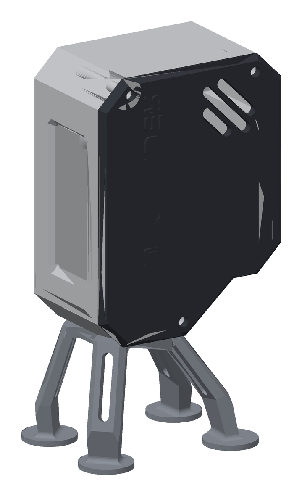

# Satellite Wi-Fi Desk Clock (ESP32-C3)

A small satellite-shaped desk clock. A DFRobot Beetle ESP32-C3 sets its time from the internet over Wi-Fi and shows hours, minutes, seconds, temperature and humidity on a 0.91 inch OLED turned on its side. An SHTC3 sensor measures the room, and a small LiPo cell keeps it running away from the cable; USB-C charges it. Remix of [OrbitClock](https://github.com/nextbuilder/orbit-clock) by NextBuilder, updated/refurbished for modern use. Print files unchanged.

## Install and build guide

### What you are building

A small satellite-shaped desk clock. A DFRobot Beetle ESP32-C3 joins your Wi-Fi, reads the time from an NTP server and shows hours, minutes, seconds, AM/PM, temperature and humidity on a 0.91 inch 128 x 32 OLED that is turned on its side. An SHTC3 sensor measures the room. A small LiPo cell lets it run without a cable for a while; USB-C charges it.

Printed parts (three files, PLA is fine):

- `Orbit Clock Housing.stl` - main body with the display window
- `Orbit Clock Cover.stl` - back cover
- `Orbit Clock Legs.stl` - landing-leg stand

The three parts share one coordinate system, so they line up if you import them together. Lay each part flat in your slicer and add supports only where it reports overhangs.

### Parts you buy separately

All shop parts are in the Bill of Material PDF. One part is not in it:

- **DFRobot Beetle ESP32-C3 (DFR0868).** The firmware and the housing are made for this exact board. Buy it from DFRobot or a DFRobot distributor. A generic "ESP32-C3 Super Mini" has a different size and pinout, so it is not a drop-in replacement.

### Step 1 - Install the software and flash the board first

Flash and test the electronics on the bench before anything goes into the housing.

1. Install the Arduino IDE (2.x).
2. In **File > Preferences > Additional boards manager URLs** add the Espressif package index: `https://espressif.github.io/arduino-esp32/package_esp32_index.json`. Then install **esp32 by Espressif Systems** in the Boards Manager.
3. Select the board **DFRobot Beetle ESP32-C3**. If the serial monitor stays empty after upload, set **USB CDC On Boot: Enabled** in the Tools menu and upload again.
4. Install these libraries with the Library Manager: **Adafruit SSD1306**, **Adafruit GFX Library**, **Adafruit SHTC3 Library** and **NTPClient** (by Fabrice Weinberg). Accept the dependency prompts (Adafruit BusIO, Adafruit Unified Sensor).
5. Open `source/upstream/Code/OrbitClock.ino` from this repository.
6. Edit these lines before you upload:
   - `ssid` and `password` (lines 10-11): your own 2.4 GHz Wi-Fi name and password. The ESP32-C3 does not connect to 5 GHz-only networks.
   - The `19800` in the `NTPClient timeClient(...)` line (line 23) is the time-zone offset in seconds (19800 = UTC+5:30). Change it to your offset, for example `3600` for UTC+1 or `0` for UTC. The sketch does not switch daylight saving time on its own; change the number when the clocks change.
   - The small header text `"maa"` (line 100) is free text. Replace it with up to about five characters of your own, or leave it.
7. Upload. Open the serial monitor at **115200 baud**. You should see dots while it connects, then `WiFi connected!`.

The sketch waits until Wi-Fi connects, then stops with a message if the display or the sensor is missing. Wire them in Step 2 before you expect a picture.

### Step 2 - Wire it on the bench

Everything runs on the I2C bus. The firmware calls `Wire.begin()` without pin numbers, so it uses the board's default I2C pins. For the DFRobot Beetle ESP32-C3 those are **GPIO 8 (SDA)** and **GPIO 9 (SCL)**.

| From | To |
|---|---|
| Beetle 3V3 | OLED VCC and SHTC3 VCC |
| Beetle GND | OLED GND and SHTC3 GND |
| Beetle GPIO 8 | OLED SDA and SHTC3 SDA |
| Beetle GPIO 9 | OLED SCL and SHTC3 SCL |
| LiPo + / - | Beetle battery pads, + to + and - to - (check the marks on your board) |

Notes:

- The OLED must be an **I2C** module with four pins (GND, VCC, SCL, SDA) at address 0x3C. Some product pages and the original write-up call it SPI; the firmware drives it over I2C.
- The circuit picture in `source/upstream/Circuit Diagram/` shows a different Beetle board (the ESP32-C6 pin layout) and an SHT40 sensor. Follow the table above; it matches the code.
- SHTC3 modules are sold as bare boards or in a small white vented housing; both work. Wire by the pin labels printed on your module, not by pin position.
- Use thin silicone wire (30 AWG) so everything fits in the housing. Keep the wires just long enough.
- The on-board LED on GPIO 10 blinks briefly every five seconds. That is normal and shows the loop is running.

Power the board from USB. After Wi-Fi connects, the OLED shows the time in a narrow vertical layout with the temperature and humidity at the bottom.

### Step 3 - Battery

Use a 3.7 V single-cell LiPo of about 400 mAh in a 303035 size or smaller so it fits behind the display. If your cell has a plug, cut it off one wire at a time and solder the leads to the battery pads, red to +. Never short the leads. Charge only through the Beetle's USB-C port, which has a charger for one LiPo cell. The original build does not add a power switch; unplug the battery to switch the clock off.

### Step 4 - Assembly

1. Fit the OLED behind the display window in the housing. A small dot of hot glue or tape at the module's edges holds it; keep glue off the glass.
2. Place the SHTC3 near a vent or the cover edge, not pressed against the Beetle, so the board's heat does not raise the reading.
3. Lay the Beetle and the battery in the housing so the USB-C port lines up with its opening.
4. Close the back with the cover and set the body on the legs.

### Step 5 - First run and checks

- Time wrong by whole hours: fix the offset in line 23 and upload again.
- Stuck at a blank screen: check the serial monitor. `SSD1306 allocation failed` means the OLED is not answering (check SDA/SCL and 3V3). `Couldn't find SHTC3` means the sensor is not answering.
- Temperature reads a few degrees high: the board warms the inside of the case. Move the sensor further from the Beetle or let the clock settle for 15 minutes before comparing.
- No Wi-Fi: only 2.4 GHz works; check the name and password in lines 10-11.
- Upload fails with the sensor and display connected: GPIO 9 is also the board's boot pin. Hold BOOT, tap RST, release BOOT and upload again (DFRobot's procedure for this board), or disconnect the SCL wire while flashing.

### Files in this project

- Print: `Orbit Clock Housing.stl`, `Orbit Clock Cover.stl`, `Orbit Clock Legs.stl`
- Firmware: `source/upstream/Code/OrbitClock.ino` in this repository
- Bill of Material PDF with shop links for each part

## Bill of Material and build guide (PDF)

- [Bill of Material (PDF)](docs/Satellite%20Wi-Fi%20Desk%20Clock%20%28ESP32-C3%29%20-%20remix%20of%20OrbitClock%20-%20Bill%20of%20Material.pdf) - every part to buy, with shop links.
- [Build Guide (PDF)](docs/Satellite%20Wi-Fi%20Desk%20Clock%20%28ESP32-C3%29%20-%20remix%20of%20OrbitClock%20-%20Build%20Guide.pdf)

## Repository contents

- `source/upstream/` - the original OrbitClock repository at commit `1a5bdbac`: the three STL print files (`CAD Design/`), the sketch (`Code/OrbitClock.ino`), the circuit picture, README and MIT `LICENSE`. The Wi-Fi name and password in lines 10-11 of the sketch are placeholders here; enter your own.
- `docs/` - this build guide as Markdown and PDF, the Bill of Material PDF, and the upstream file manifest with hashes.
- `images/` - cover image.

## Credits and license

Original design, code, text and photos: NextBuilder, OrbitClock - https://github.com/nextbuilder/orbit-clock

Licensed under the [MIT License](https://opensource.org/license/mit) - see `LICENSE`.

Changes in this repository: a rewritten build guide, a current Bill of Material and this repository layout, and the Wi-Fi name/password in the sketch replaced with placeholders. The print files are unchanged.
